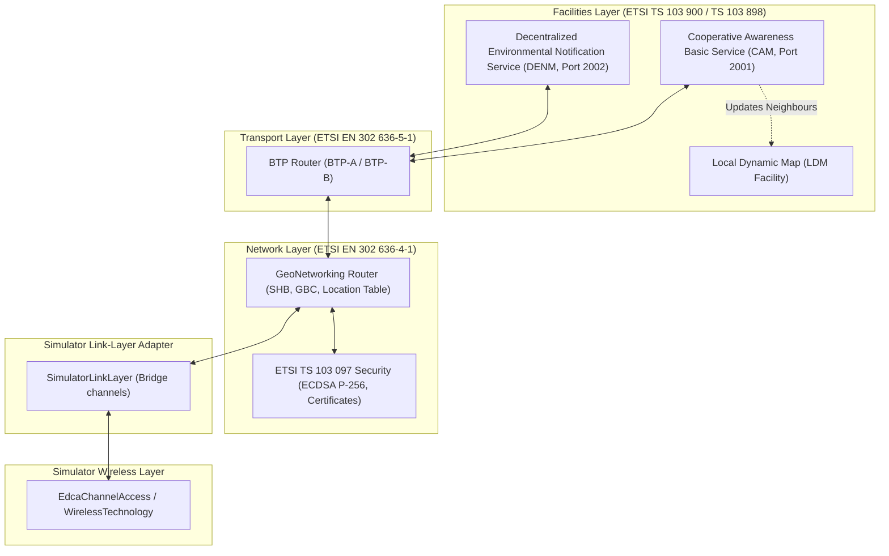

# ETSI C-ITS Protocol Stack Integration

`rustv2xsimulator` integrates natively with **[`rustflexstack`](https://flexstack.eu)**, providing a memory-safe, zero-copy implementation of European Telecommunications Standards Institute (ETSI) Cooperative Intelligent Transport Systems (C-ITS) protocol standards.

---

## 1. Protocol Architecture

The communication stack mirrors the European C-ITS architecture (ETSI EN 302 665):

---

## 2. Standards Compliance

| Layer / Service | ETSI Specification | Implementation Details |
| :--- | :--- | :--- |
| **Facilities Layer** | **ETSI TS 103 900** (CAM) **ETSI TS 103 898** (DENM) | Dynamic kinematic triggers ($|\Delta d| \ge 4\,\text{m}$, $|\Delta \theta| \ge 4^\circ$, $|\Delta v| \ge 0.5\,\text{m/s}$), UPER ASN.1 encoding via `rasn`. |
| **Transport Layer** | **ETSI EN 302 636-5-1** (BTP) | BTP-B for CAM broadcasts (Port 2001); BTP-A for port-directed packets. |
| **Network Layer** | **ETSI EN 302 636-4-1** (GeoNet) | Single-Hop Broadcast (SHB), GeoBroadcast (GBC), Long Position Vector (LPV) location tables. |
| **Security Subsystem** | **ETSI TS 103 097** / **IEEE 1609.2** | ECDSA P-256 signing, certificate verification backend, SHA-256 digest calculation. |
| **Local Dynamic Map** | **ETSI EN 302 895** (LDM) | High-speed spatial hash map tracking neighbor vehicle kinematics and Age of Information (AoI). |

---

## 3. The `SimulatorLinkLayer` Bridge

In a physical vehicle, the GeoNetworking router communicates with the wireless network interface card (NIC) over Linux raw sockets (`AF_PACKET` via `libpnet`).

Inside the discrete-event simulator, [`SimulatorLinkLayer`](../../src/cits/link_layer.rs) bridges `rustflexstack` to the DES channel without OS socket overhead:

- **Outbound Frames**: GeoNetworking packets ready for wireless broadcast are queued in `gn_to_ll_rx`. The simulation engine polls them via `drain_outbound_frames()`, maps them to the appropriate Access Category (`AC_BE` for CAM, `AC_VO` for DENM), and submits them to the MAC contention engine.
- **Inbound Frames**: When a wireless packet is successfully decoded by the PHY layer, the engine calls `inject_rx(&payload_bytes)`. The frame enters the GeoNetworking router, updates the receiver's location table, passes through BTP, and reaches the facility layer (updating the Local Dynamic Map).
