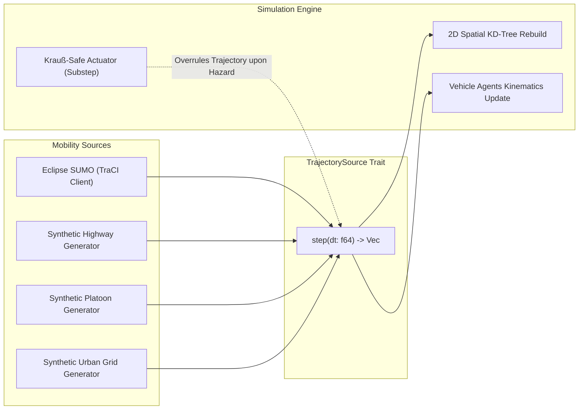

# Vehicular Mobility & SUMO TraCI Integration

This document covers how vehicle motion, microscopic traffic simulation, and emergency brake actuation are modeled in **`rustv2xsimulator`**.

---

## 1. Mobility Architecture

Vehicular mobility can be driven by either:

1. **Eclipse SUMO (Simulation of Urban MObility)** via the TraCI socket protocol.
2. **Built-in Synthetic Mobility Generators** (Highways, Platoons, Urban Grids) for fast headless benchmarking without external dependencies.

---

## 2. Eclipse SUMO TraCI Client

The simulator embeds a TraCI client that communicates with SUMO or SUMO-GUI over a TCP socket (default port `8813`):

- **Stepping**: The simulation engine steps SUMO by `mobility_step_s` (typically $0.1\,\text{s} = 100\,\text{ms}$).
- **State Ingestion**: At every step, the engine fetches:
  - 2D Cartesian coordinates $(x, y)$ in SUMO metric coordinates.
  - Vehicle speed ($v$ in m/s) and acceleration ($a$ in $\text{m/s}^2$).
  - Heading angle ($\theta$ in degrees from North).
  - Leader vehicle ID and longitudinal headway gap.
- **WGS84 Projection**: Uses [`GeodeticTransform`](../../src/common/geo.rs) to accurately map SUMO local metric coordinates to global WGS84 GPS latitude and longitude ($10^{-7}$ degree precision required by ETSI CAM).

---

## 3. Krauß-Safe Emergency Brake Actuator

When an Emergency Electronic Brake Light (EEBL) Decentralized Environmental Notification Message (DENM) is received from a leading vehicle, the receiving agent must brake to avoid a collision.

Implemented in [`KraussSafeActuator`](../../src/mobility/krauss_actuation.rs):

- **Collision Checking**: Evaluates safe following distances under the Krauß car-following model:

  $$v_{safe} = v_{lead} + \frac{g - v_{lead} \tau}{\frac{\bar{v}}{2 b} + \tau}$$

  *(where $g$ is the headway gap, $\tau$ is driver reaction time, and $b$ is maximum comfortable deceleration).*

- **Sub-Step Actuation**: Rather than waiting for the next coarse SUMO step (which might take up to 100 ms), the actuator performs continuous micro-substepping:

  $$d(t) = d_0 + v_0 t + \frac{1}{2} a t^2$$

  detecting collisions with millisecond fidelity and feeding the updated deceleration back into SUMO via `traci::vehicle::slowDown()`.

---

## 4. Synthetic Mobility Generators

For rapid benchmarking and continuous integration (CI) where SUMO is not installed, the simulator provides built-in trajectory generators:

- **`SyntheticMobilityType::Highway`**: Multi-lane unidirectional highway with Poisson arrivals and Krauß car-following.
- **`SyntheticMobilityType::Platoon`**: Tight-headway vehicular platoon ($d_{gap} \in [5, 15]\,\text{m}$) ideal for evaluating Age of Information (AoI) and safety beacon latency.
- **`SyntheticMobilityType::Urban`**: Manhattan grid with orthogonal streets and traffic-light intersections.
