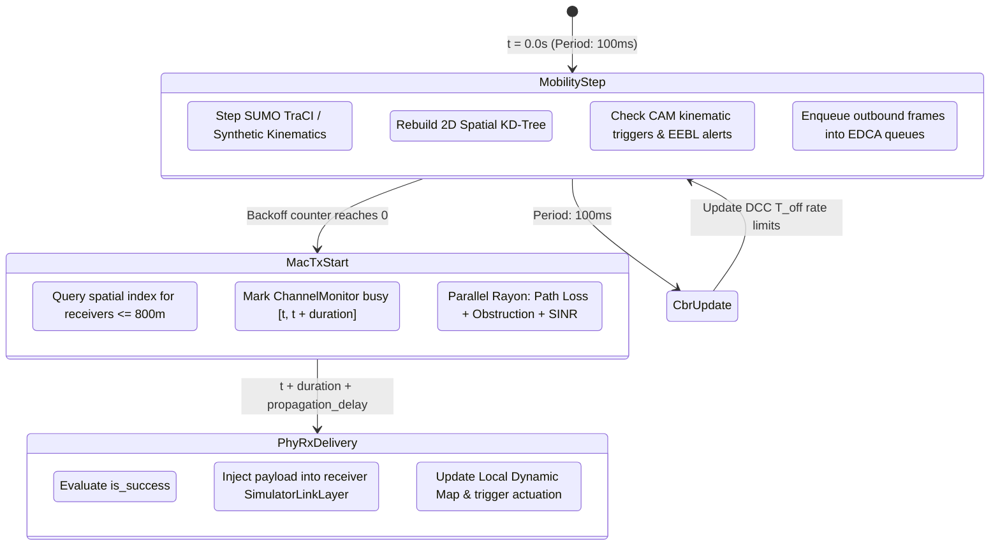

# Core DES Engine & Simulation Architecture

This document describes the internal discrete-event simulation (DES) engine of **`rustv2xsimulator`**, how time advances, and how the simulation pipeline orchestrates cross-layer vehicular events.

---

## 1. Discrete-Event Scheduling & Time Model

A fundamental requirement for vehicular research simulations is **strict determinism** and **high-precision event scheduling**.

### The `SimTime` Primitive
Time is tracked using the [`SimTime`](../../src/common/time.rs) value object, which stores ticks as an unsigned 64-bit integer (`u64`) where:

$$1 \text{ tick} = 100 \text{ nanoseconds} = 10^{-7} \text{ seconds}$$

This resolution enables:

- Accurate representation of IEEE 802.11p slot times ($13\,\mu\text{s} = 130 \text{ ticks}$) and SIFS ($32\,\mu\text{s} = 320 \text{ ticks}$).
- Microscopic propagation delays over sub-kilometer distances ($\sim 3.33\,\mu\text{s/km}$).
- Representation of simulation durations over 50,000 years without numeric overflow.

### Min-Heap Priority Calendar Queue
Events are scheduled in a priority queue (`DiscreteEventScheduler`) implemented over a binary min-heap (`std::collections::BinaryHeap`).

Events are strictly ordered by:

1. **Timestamp** (`SimTime`): Earliest event executed first.
2. **Priority level** (`u8`): Lower integer = higher priority (tie-breaking at identical timestamps).
3. **Insertion sequence counter** (`u64`): Guarantees FIFO tie-breaking for identical timestamp and priority, preventing non-deterministic re-ordering.

---

## 2. Event Payloads & Simulation Lifecycle

The discrete-event engine steps monotonically through simulation events. The central event enum [`EventPayload`](../../src/scheduler/event.rs) defines the core simulation interactions:



### Event Descriptions

| Event | Fired By | Description |
| :--- | :--- | :--- |
| **`MobilityStep`** | Engine timer | Advances microscopic vehicle positions (TraCI or synthetic), updates KD-tree, evaluates CAM generation conditions, drains link layer bridges, and starts MAC backoff. |
| **`MacTxStart`** | MAC backoff completion | Fired when an agent's CSMA/CA backoff countdown finishes. Marks channel busy on sender and candidate receivers; evaluates wireless channel in parallel via Rayon. |
| **`PhyRxDelivery`** | PHY delivery timer | Scheduled at $t_{now} + \text{duration} + \text{delay}$. If reception was successful, delivers raw packet bytes to the receiving agent's GeoNetworking router. |
| **`CbrUpdate`** | Periodic monitor | Evaluates Channel Busy Ratio (CBR) over a 100 ms sliding window in `ChannelMonitor` and feeds it to DCC rate controllers (Reactive FSM or LIMERIC). |
| **`KraussBrakeActuation`** | EEBL receiver | Actuates emergency braking sub-stepping in `KraussSafeActuator` when a forward hazard DENM is received. |

---

## 3. The Simulation Step Loop

A typical stepping loop advances the discrete scheduler event by event:

```rust
while let Some(event) = engine.step()? {
    match event.payload {
        EventPayload::MobilityStep { step_index } => {
            engine.handle_mobility_step(step_index)?;
        }
        EventPayload::MacTxStart { packet_id, sender_id, access_category, payload_bytes } => {
            engine.handle_mac_tx(packet_id, sender_id, access_category, payload_bytes)?;
        }
        EventPayload::PhyRxDelivery { packet_id, sender_id, receiver_id, payload_bytes, rx_power_dbm, sinr_db, is_success } => {
            engine.handle_phy_rx(packet_id, sender_id, receiver_id, payload_bytes, rx_power_dbm, sinr_db, is_success)?;
        }
        EventPayload::CbrUpdate { node_id } => {
            engine.handle_cbr_update(node_id)?;
        }
        _ => {}
    }
}
```

This decoupled architecture ensures that researchers can hook into any event to collect custom metrics, log custom traces, or override protocols without modifying the core simulation loop.
