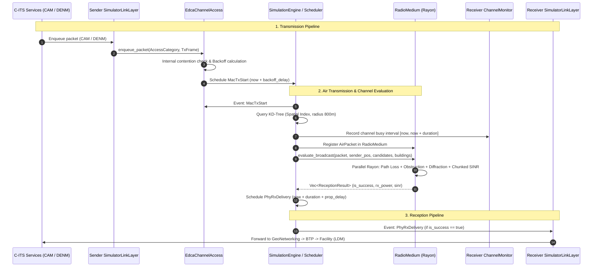
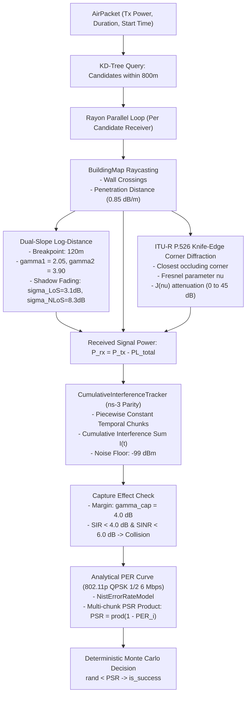

# Physical Layer & MAC Layer Architecture in RustV2XSimulator

This document provides a comprehensive technical overview and deep dive into the **Physical (PHY) Layer** and **Medium Access Control (MAC) Layer** implementations in [`rustv2xsimulator`](../getting_started/developer_guide.md).

---

## 1. High-Level Architecture & Simulation Lifecycle

The simulator is built around a deterministic, discrete-event simulation (DES) engine ([`DiscreteEventScheduler`](../../src/scheduler/des.rs)) operating with a 100-nanosecond tick resolution (`SimTime`). The MAC and PHY layers work in tight coordination with the vehicular mobility engine and the ETSI C-ITS protocol stack ([`rustflexstack`](../../RustFlexstack/README.md)).



---

## 2. MAC Layer (`src/mac/`)

The MAC layer is implemented in [`src/mac/`](../../src/mac/mod.rs) and provides:

1. **IEEE 802.11p EDCA (Enhanced Distributed Channel Access)** with 4 Access Categories (ACs).
2. **Internal contention resolution** between AC queues within the same node.
3. **Backoff delay computation** and slot-based CSMA/CA countdown.
4. **Channel Busy Ratio (CBR) monitoring** over sliding observation windows for Decentralized Congestion Control (DCC).

### 2.1. Access Categories & Contention Parameters

In IEEE 802.11p (10 MHz channel bandwidth in the 5.9 GHz ITS band), medium access priority is enforced by tailoring the **Arbitration Inter-Frame Space Number ($AIFSN$)** and the **Contention Window ($CW$)** limits for each Access Category:

| Access Category | Identifier | Target Traffic Type | $AIFSN$ | $CW_{min}$ | $CW_{max}$ |
| :--- | :--- | :--- | :---: | :---: | :---: |
| **`VoiceSafety`** | `AC_VO` (0) | Emergency / High-Priority Safety (DENM) | **2** | **3** | **7** |
| **`Video`** | `AC_VI` (1) | High-throughput video / perception sharing | **3** | **7** | **15** |
| **`BestEffort`** | `AC_BE` (2) | Standard periodic Cooperative Awareness (CAM) | **6** | **15** | **1023** |
| **`Background`** | `AC_BK` (3) | Non-safety background telemetry | **9** | **15** | **1023** |

*Source Reference:* [`EdcaQueueConfig::for_ac`](../../src/mac/edca.rs).

### 2.2. Timing Parameters & Frame Transmission Duration

*   **Slot Time ($\sigma$)**: $13\,\mu\text{s}$ ([`slot_time`](../../src/mac/edca.rs))
*   **SIFS (Short Interframe Space)**: $32\,\mu\text{s}$ ([`sifs`](../../src/mac/edca.rs))
*   **CCA Threshold**: $-85.0\,\text{dBm}$

#### Arbitration Inter-Frame Space ($AIFS$)

$$AIFS[AC] = SIFS + AIFSN[AC] \times \sigma$$

#### Backoff Contention Delay
When a frame is queued for transmission, a uniform random backoff is selected:

$$\text{backoff\_slots} \in [0, CW_{min}]$$

$$\text{Delay}_{contention} = AIFS[AC] + \text{backoff\_slots} \times \sigma$$

#### 802.11p Frame Duration on Air
For an OFDM transmission at 6 Mbps with QPSK rate-1/2 over a 10 MHz channel ($N_{DBPS} = 24$ data bits per OFDM symbol of $8\,\mu\text{s}$ duration), the packet duration is calculated in [`compute_duration_10mhz`](../../src/mac/edca.rs):

$$\text{duration} = 40\,\mu\text{s} + \left\lceil \frac{16 + 8 \times L_{bytes} + 6}{24} \right\rceil \times 8\,\mu\text{s}$$

*(where $40\,\mu\text{s}$ accounts for the physical preamble and PLCP header, 16 bits for SERVICE field, and 6 tail bits).*

### 2.3. Internal Contention Resolution

Each vehicle node owns an [`EdcaChannelAccess`](../../src/mac/edca.rs) with four queues ([`EdcaQueue`](../../src/mac/edca.rs)). When multiple queues have pending frames:

1. [`poll_ready_transmission`](../../src/mac/edca.rs) evaluates queues in descending order of priority:

   $$\text{VoiceSafety} > \text{Video} > \text{BestEffort} > \text{Background}$$

2. The winning queue dequeues its frame, resets its contention window $CW \leftarrow CW_{min}$, and transitions to `MacState::Idle`.
3. The remaining subordinate queues with pending traffic encounter an **internal collision**:

   $$CW \leftarrow \min(2 \times CW + 1, CW_{max})$$

   and draw a new random backoff counter ([`on_internal_collision`](../../src/mac/edca.rs)).

### 2.4. Channel Monitor & Channel Busy Ratio (CBR)

The [`ChannelMonitor`](../../src/mac/channel_monitor.rs) tracks local channel utilization over a sliding window $T_{CBR} = 100\,\text{ms}$:

1. **Interval Tracking**: When any transmission starts in transmission range, [`record_busy_interval(start, end)`](../../src/mac/channel_monitor.rs) logs the active period.
2. **Window Trimming**: In [`evaluate_cbr(now)`](../../src/mac/channel_monitor.rs), all historical intervals ending prior to $\text{now} - T_{CBR}$ are pruned.
3. **Overlapping Interval Union**: Because multiple transmissions may overlap in time, intervals are sorted and merged into disjoint busy segments:

   $$T_{busy} = \bigcup_{k} [start_k, end_k] \cap [now - T_{CBR}, now]$$

4. **CBR Ratio**:

   $$\text{CBR} = \frac{T_{busy}}{T_{CBR}} \in [0.0, 1.0]$$

5. **DCC Interaction**: Every 100 ms, the simulation engine triggers `EventPayload::CbrUpdate`, which queries `evaluate_cbr()` and feeds it into the vehicle's Decentralized Congestion Control (either [`ReactiveDccFsm`](../../src/dcc/reactive_fsm.rs) or [`LimericDcc`](../../src/dcc/limeric.rs)) to throttle CAM transmission intervals ($T_{off}$).

---

## 3. Physical (PHY) Layer (`src/phy/`)

The physical layer resides in [`src/phy/`](../../src/phy/mod.rs). It manages radio wave propagation, obstacle attenuation, corner diffraction, cumulative interference, capture effects, and frame error decoding.



### 3.1. Parallel Evaluation & Spatial Filtering

When [`handle_mac_tx`](../../src/engine.rs) fires:

1. The engine constructs an [`AirPacket`](../../src/phy/air_packet.rs) ($P_{tx} = 23\,\text{dBm}$, standard duration $\sim 300\,\mu\text{s}$).
2. The 2D spatial index ([`SpatialIndex`](../../src/geometry/kd_tree.rs)) finds all candidate receivers within a **cutoff radius of $800\,\text{m}$**.
3. All candidates are evaluated concurrently using [`rayon::prelude::*`](../../src/phy/radio_medium.rs).
4. Each receiver utilizes a **deterministic pseudo-random generator** keyed to the simulation seed, packet ID, receiver ID, and iteration index:
   ```rust
   let mut rng = StdRng::seed_from_u64(
       sim_seed ^ ((packet.packet_id << 32) | (rx_id as u64)) ^ (idx as u64)
   );
   ```

---

### 3.2. Propagation and Path Loss Models

The simulator offers two selectable PHY models ([`PhyModelType`](../../src/phy/radio_medium.rs)):

#### 1. Dual-Slope Log-Distance Model (`PhyModelType::DualSlope`, Default)
Implemented in [`DualSlopePathLoss`](../../src/phy/path_loss.rs):

- **Carrier Frequency**: $f_c = 5.9\,\text{GHz}$.
- **Reference Path Loss at $d_0 = 1.0\,\text{m}$**:

  $$PL_0 = 20 \log_{10}\left( \frac{4 \pi \cdot 1.0 \cdot f_c}{c} \right) \approx 47.85\,\text{dB}$$

- **Breakpoint Distance ($d_{break}$)**: $120.0\,\text{m}$.
- **Path Loss Exponents**: $\gamma_1 = 2.05$ (before breakpoint), $\gamma_2 = 3.90$ (after breakpoint).

**Deterministic Path Loss**:

$$PL_{det}(d) = \begin{cases} 
PL_0 + 10 \gamma_1 \log_{10}(d), & d \le d_{break} \\ 
PL_0 + 10 \gamma_1 \log_{10}(d_{break}) + 10 \gamma_2 \log_{10}\left(\frac{d}{d_{break}}\right), & d > d_{break} 
\end{cases}$$

**Log-Normal Shadow Fading ($X_\sigma$)**:
A zero-mean Gaussian random variable sampled according to Line-of-Sight conditions:

$$X_\sigma \sim \mathcal{N}(0, \sigma^2)$$

- Line-of-Sight ($\text{LoS}$): $\sigma_{LoS} = 3.1\,\text{dB}$
- Non-Line-of-Sight ($\text{NLoS}$): $\sigma_{NLoS} = 8.3\,\text{dB}$

---

#### 2. Building Obstruction & Wall Penetration Attenuation
Implemented in [`BuildingMap::evaluate_obstruction`](../../src/geometry/polygon.rs):

- Intersects the transmitter-to-receiver 2D ray against all building polygons parsed from SUMO/OSM (`osm.poly.xml`).
- Calculates cumulative internal penetration distance ($d_{pen}$).
- Computes concrete attenuation:

  $$PL_{penetration} = \min(d_{pen} \times 0.85\,\text{dB/m},\, 45.0\,\text{dB})$$

- If any building is intersected, $\text{LoS}$ is set to `false`.

---

#### 3. ITU-R P.526 Knife-Edge Corner Diffraction
Implemented in [`FresnelKnifeEdge`](../../src/phy/knife_edge.rs):
When a building obstructs the direct line of sight, the simulator extracts the closest corner vertex of the building to the ray and calculates continuous corner diffraction:

1. **Fresnel-Kirchhoff dimensionless parameter $\nu$**:

   $$\nu = h \sqrt{\frac{2(d_1 + d_2)}{\lambda d_1 d_2}}$$

   *(where $h$ is the clearance distance, $\lambda = c / f_c \approx 0.0508\,\text{m}$, and $d_1, d_2$ are distances from TX and RX to the corner vertex).*
2. **Diffraction Loss $J(\nu)$**:

   $$J(\nu) = \begin{cases}
   0\,\text{dB}, & \nu \le -0.78 \\
   \left[ 6.9 + 20 \log_{10}\left( \sqrt{(\nu - 0.1)^2 + 1} + \nu - 0.1 \right) \right]_{0}^{45\,\text{dB}}, & \nu > -0.78
   \end{cases}$$

**Total Received Power**:

$$P_{rx} = P_{tx} - \Big( PL_{det}(d) + X_\sigma + PL_{penetration} + J(\nu) \Big)$$

---

#### 4. Legacy Polynomial Model (`PhyModelType::LegacyPoly`, Baseline)
Implemented in [`LegacyPolynomialPathLoss`](../../src/phy/path_loss.rs) for ablation study $A4$:

- Uses an empirical 10th-degree polynomial to evaluate distance loss:

  $$P_{loss, dist}(d) = \sum_{k=0}^{10} C_k d^k \quad (\text{clamped to } [0, 1])$$

- Combines distance loss with a logistic function modeling channel congestion based on local bytes on air:

  $$P_{loss, cong}(B) = \frac{1}{1 + e^{-k (B - b_0)}}$$

- Delivery probability: $P_{deliver} = (1 - P_{loss, dist}) \times (1 - P_{loss, cong})$ if LoS, else 0.

---

### 3.3. Chunked Cumulative SINR & Receiver Capture Effect

Implemented in [`CumulativeInterferenceTracker`](../../src/phy/interference_helper.rs), closely mirroring the ns-3 v3.42 `InterferenceHelper` architecture.

```mermaid
gantt
    title Piecewise-Constant Interference Chunking
    dateFormat X
    axisFormat %s ms
    section Desired Signal
    Desired Packet (P_desired) :active, d1, 0, 10
    section Interferer A
    Interferer A (P_intf_A)    :crit, a1, 0, 4
    section Interferer B
    Interferer B (P_intf_B)    :crit, b1, 3, 7
    section Resulting Chunks
    Chunk 1 (0-3 ms, I = P_A)            :done, c1, 0, 3
    Chunk 2 (3-4 ms, I = P_A + P_B)      :crit, c2, 3, 4
    Chunk 3 (4-7 ms, I = P_B)            :done, c3, 4, 7
    Chunk 4 (7-10 ms, Noise only)        :active, c4, 7, 10
```



#### 1. Piecewise Constant Slicing
When a packet reception occurs:

1. The tracker collects all boundary timestamps (start and end times) of concurrent transmissions active during $[t_{start}, t_{end}]$.
2. It divides the packet reception interval into contiguous time slices $[t_i, t_{i+1}]$ of duration $\Delta t_i$.
3. For each slice $i$, the total interfering power is summed in linear Watts:

   $$I_i = \sum_{j \in \text{interferers}} P_{rx, j}(t_{mid})$$

   $$\text{SINR}_i = \frac{P_{rx, desired}}{I_i + N_0}$$

   *(where thermal noise floor $N_0 = -99.0\,\text{dBm} \approx 1.259 \times 10^{-13}\,\text{W}$).*

#### 2. Receiver Capture Effect ($\gamma_{cap} = 4.0\,\text{dB}$)
If interfering signals overlap with the desired packet:

- The Signal-to-Interference Ratio is computed:

  $$\text{SIR}_i = \frac{P_{rx, desired}}{I_i}$$

- **Capture condition**: If $\text{SIR}_i < 4.0\,\text{dB}$ and $\text{SINR}_i < 6.0\,\text{dB}$, destructive collision occurs and reception fails immediately ($\text{PSR} = 0$).
- If $\text{SIR}_i \ge 4.0\,\text{dB}$, the receiver successfully **captures** the stronger desired packet over the interferer.

#### 3. Analytical Packet Error Rate (PER) Curve
For each chunk, the Packet Error Rate for IEEE 802.11p OFDM 6 Mbps (QPSK 1/2 with convolutional coding) is computed using the ns-3 `NistErrorRateModel` logistic curve in [`compute_80211p_coded_per`](../../src/phy/interference_helper.rs):

$$\text{PER}_i(\text{SINR}_i) = \begin{cases}
1.0, & \text{SINR}_{i,\text{dB}} < 2.0\,\text{dB} \\
0.0, & \text{SINR}_{i,\text{dB}} > 12.0\,\text{dB} \\
\min\left(1.0, \, \frac{1}{1 + \exp\left(1.6 (\text{SINR}_{i,\text{dB}} - 5.5)\right)} \times \text{clamp}\left(\frac{L_{bytes}}{300}, 0.5, 3.0\right)\right), & 2.0 \le \text{SINR}_{i,\text{dB}} \le 12.0
\end{cases}$$

#### 4. Total Packet Success Rate (PSR)
The probability of receiving the entire packet successfully is the product of success probabilities across all time chunks:

$$\text{PSR} = \prod_{i} (1 - \text{PER}_i)$$

Finally, a random float $u \sim \mathcal{U}(0, 1)$ determines whether the reception succeeds ($u < \text{PSR}$).

---

## 4. Verification & ns-3 Parity

The PHY layer has been validated against an ns-3 v3.42 gold standard in [`tests/ns3_phy_parity_test.rs`](../../tests/ns3_phy_parity_test.rs):

- **Packet Delivery Ratio (PDR)** is evaluated across $10\,\text{m}$ distance bins up to $800\,\text{m}$.
- Mean Absolute Error (MAE) against ns-3 is asserted to satisfy:

  $$\text{MAE}_{\text{PDR}} \le 0.04$$

- The integration test verifies that the dual-slope breakpoint, log-normal shadowing, and analytical error models match standard ns-3 link behavior with high fidelity.

---

## 5. Summary Table: MAC vs. PHY Layer Responsibilities

| Dimension | MAC Layer (`src/mac/`) | PHY Layer (`src/phy/`) |
| :--- | :--- | :--- |
| **Primary Module** | [`EdcaChannelAccess`](../../src/mac/edca.rs) & [`ChannelMonitor`](../../src/mac/channel_monitor.rs) | [`RadioMedium`](../../src/phy/radio_medium.rs) & [`CumulativeInterferenceTracker`](../../src/phy/interference_helper.rs) |
| **Standards** | IEEE 802.11p EDCA, ETSI TS 102 687 (DCC) | IEEE 802.11p PHY, ITU-R P.526, ns-3 v3.42 |
| **QoS / Prioritization** | 4 Access Categories (`AC_VO`, `AC_VI`, `AC_BE`, `AC_BK`) | Equal treatment at RF; prioritized by TX duration & backoff |
| **Collision Resolution**| Internal contention (CW doubling), Backoff delay | Receiver capture effect ($\gamma_{cap} = 4\,\text{dB}$), SINR degradation |
| **Channel Evaluation** | CBR over sliding $100\,\text{ms}$ window | Path loss, shadow fading, building penetration, diffraction |
| **Concurrency** | Per-agent state machines, single-threaded DES dispatch | Parallel multi-receiver broadcast evaluation using **Rayon** |
| **Event Triggers** | Schedules `MacTxStart` when backoff completes | Schedules `PhyRxDelivery` at duration + propagation delay |
