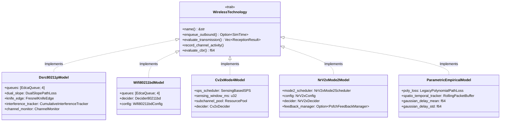

# Pluggable Wireless Trait Abstraction

To ensure `rustv2xsimulator` is completely customizable and can support both physics-based DSRC and empirical models today—as well as C-V2X, NR-V2X, and BLE in the future—the simulator defines a modular **trait-based abstraction**.

---

## 1. Architectural Motivation

In standard vehicular network simulators (like legacy NS-2 or monolithic C++ simulators), physical and MAC layer models are often deeply coupled to the discrete event loop. This makes it difficult to:

- Benchmark a fast empirical model against a full PHY model without maintaining separate forks.
- Compare IEEE 802.11p against 3GPP C-V2X PC5 Mode 4 under identical vehicular mobility and C-ITS traffic.
- Experiment with multi-radio vehicular nodes (e.g. DSRC + 5G NR sidelink fallback).

`rustv2xsimulator` solves this by decoupling the vehicular protocol stack and mobility engine from the radio medium via clean Rust traits.

---

## 2. The `WirelessTechnology` Trait

The core abstraction decouples **channel access (MAC)**, **channel propagation and interference (PHY)**, and **congestion monitoring (CBR)**:

```rust
pub trait WirelessTechnology: Send + Sync {
    /// Human-readable technology identifier (e.g., "DSRC_80211p", "Parametric_Empirical", "CV2X_Mode4")
    fn name(&self) -> &'static str;

    /// Called by the agent link-layer when an outbound frame is generated
    /// Returns the scheduled transmission timestamp (SimTime) considering medium access delay
    fn enqueue_outbound(
        &mut self,
        frame: TxFrame,
        access_category: u8,
        now: SimTime,
        rng: &mut StdRng,
    ) -> Option<SimTime>;

    /// Evaluate reception across candidate receivers when an AirPacket transmission occurs
    fn evaluate_transmission(
        &mut self,
        packet: &AirPacket,
        sender_pos: Point2D,
        receivers: &[(ActorId, Point2D, f64)],
        buildings: &BuildingMap,
        now: SimTime,
        rng: &mut StdRng,
    ) -> Vec<ReceptionResult>;

    /// Update channel busy state or sensing window
    fn record_channel_activity(&mut self, start: SimTime, end: SimTime);

    /// Periodic congestion monitor query (e.g., CBR for 802.11p or CBR_sidelink for C-V2X)
    fn evaluate_cbr(&mut self, now: SimTime) -> f64;
}
```

---

## 3. Technology Implementation Map



### Supported Models:

1. **[`Dsrc80211pModel`](../technologies/dsrc_80211p.md)**:
   - Channel Access: IEEE 802.11p EDCA with 4 AC queues (`AC_VO`, `AC_VI`, `AC_BE`, `AC_BK`), CW doubling upon internal contention, slot-based CSMA/CA backoff with freeze/resume.
   - Channel Physics: Dual-slope log-distance path loss, building ray-cast penetration, ITU-R P.526 corner diffraction, Rayon-parallel piecewise-constant cumulative SINR, 4.0 dB capture effect, and precomputed NIST 8-level MCS LUT.
   - Congestion: 100 ms sliding window Channel Busy Ratio (CBR) monitoring for DCC.

2. **[`Wifi80211bdModel`](../technologies/wifi80211bd.md)**:
   - Channel Access: Enhanced EDCA with Mixed PPDU framing (72 µs legacy preamble + L-SIG spoofing for 802.11p coexistence).
   - Channel Physics: Midamble tracking for Doppler spread (speeds up to 220 km/h), QC-LDPC coding gain (+2.5 to 3.0 dB), Dual Carrier Modulation (DCM), and MCS 0..9 in 10/20 MHz channels.

3. **[`Cv2xMode4Model`](../technologies/cv2x_pc5_mode4.md)**:
   - Channel Access: 3GPP Release 14/15 Sensing-Based Semi-Persistent Scheduling (SB-SPS) over a rolling 1000 ms sensing window with candidate single-subframe resource (CSR) filtering.
   - Channel Physics: 2D time-frequency resource grid (10/20 MHz, 10 RBs per subchannel), Turbo coding, and dual PSCCH/PSSCH BLER decider.

4. **[`NrV2xMode2Model`](../technologies/nr_v2x_mode2.md)**:
   - Channel Access: 3GPP Release 16/17 Mode 2 autonomous selection window $[n+T_1, n+T_2]$, Release 16 $T_3$ Re-evaluation lookahead check, priority pre-emption, and closed-loop PSFCH HARQ feedback.
   - Channel Physics: Flexible numerologies ($\mu \in \{0, 1, 2\}$, 15/30/60 kHz SCS), Two-Stage SCI (Format 1-A + Format 2-A), and calibrated NR-LDPC / Polar BLER waterfall curves.

5. **[`ParametricEmpiricalModel`](../technologies/parametric_legacy.md)**:
   - Channel Access: Unslotted immediate access with Gaussian random propagation delay.
   - Channel Physics: 10th-degree empirical distance polynomial ($d \le 350\,\text{m}$), 1-second spatio-temporal logistic congestion tracking ($200\,\text{m}$ radius), and binary building line-of-sight drop.

---

## 4. Swapping Technologies at Runtime

Switching between models can be performed via CLI flag in the `cam_simulation` example:

```bash
# Run with IEEE 802.11p DSRC (default)
cargo run --release --example cam_simulation -- --technology 11p

# Run with IEEE 802.11bd Next-Gen V2X at MCS 4
cargo run --release --example cam_simulation -- --technology 11bd --mcs 4

# Run with 3GPP C-V2X PC5 Mode 4
cargo run --release --example cam_simulation -- --technology cv2x

# Run with 3GPP 5G NR-V2X Mode 2
cargo run --release --example cam_simulation -- --technology nrv2x --mcs 10

# Run with the fast Parametric empirical model
cargo run --release --example cam_simulation -- --technology parametric
```

Or configured declaratively in scenario `.toml` files:

```toml
[phy]
model = "dualslope" # Options: "dualslope" (802.11p), "wifi80211bd", "cv2x", "nr_v2x", "legacy_poly"
```

Because all higher protocol layers (GeoNetworking, BTP, CAM basic service, DENM service) communicate via standard packet byte vectors, switching the underlying wireless model requires **zero changes** to your application logic, scenarios, or metrics collection scripts.
