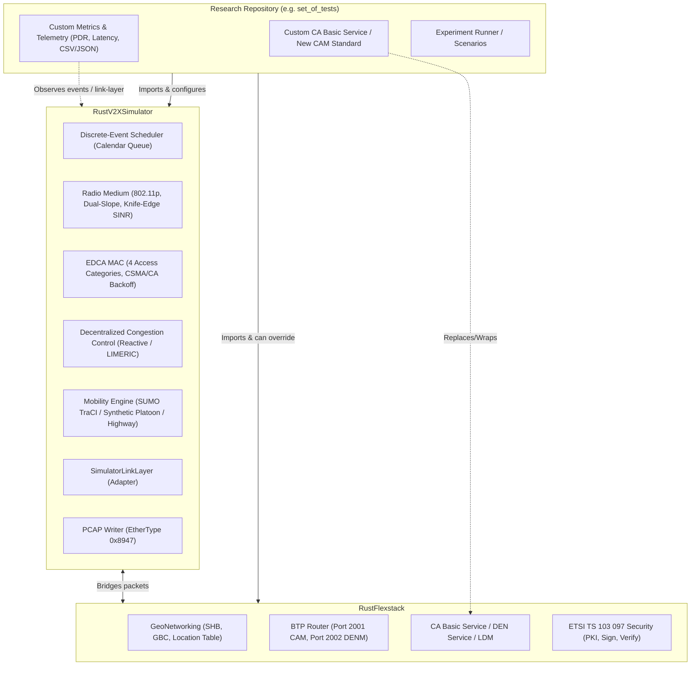

# RustV2XSimulator: Developer & Agent Guide

This guide describes the architecture of **`rustv2xsimulator`**, how it integrates with **`rustflexstack`**, and how downstream research repositories (such as experiment testbenches and paper evaluation suites) should import, override, and collect custom metrics.

---

## 1. Architectural Philosophy

`rustv2xsimulator` is designed as a **lean, unopinionated discrete-event simulation (DES) framework** for vehicular communications (V2X). It provides the physics, medium access, mobility, and event scheduling environment, while relying on `rustflexstack` for the ETSI C-ITS protocol stack.



### Separation of Responsibilities

| Responsibility | Handled By | Description |
| :--- | :--- | :--- |
| **Event Scheduling & Time** | `rustv2xsimulator::scheduler` | Deterministic, discrete-event calendar queue (`SimTime` in 100 ns ticks). |
| **Wireless Channel & RF** | `rustv2xsimulator::phy` | Path loss (dual-slope), shadow fading, knife-edge diffraction, cumulative SINR. |
| **Channel Access & Contention** | `rustv2xsimulator::mac` | IEEE 802.11p EDCA 4 Access Categories (`AC_VO`, `AC_VI`, `AC_BE`, `AC_BK`), CBR monitor. |
| **Vehicular Mobility** | `rustv2xsimulator::mobility` | SUMO TraCI client, synthetic grid/highway/platoon generators. |
| **Packet Trace Capture** | `rustv2xsimulator::pcap` | High-speed libpcap export parseable directly in Wireshark (`0x8947`). |
| **ETSI Protocol Layers** | `rustflexstack` | GeoNetworking (EN 302 636-4-1), BTP (EN 302 636-5-1), Facilities (TS 103 900), Security (TS 103 097). |
| **Metrics & Research Logic** | **Downstream Repository** | PDR curves, throughput, latency distributions, paper-specific metrics collectors. |

---

## 2. Downstream Repository Setup

When starting a new research experiment (e.g. testing a modified CAM standard or a custom congestion control mechanism), create a new Cargo workspace or package that imports both crates:

```toml
[dependencies]
# Simulator engine (DES, PHY, MAC, Mobility, PCAP)
rustv2xsimulator = { git = "https://github.com/Fundacio-i2CAT/RustV2XSimulator.git" }
# Note: Once published to crates.io, replace with:
# rustv2xsimulator = "0.1"

# ETSI C-ITS Protocol Stack (from crates.io)
rustflexstack = "0.3.4"
```

> [!NOTE]
> **Future Crates.io Release**: Once `rustv2xsimulator` is officially published to [crates.io](https://crates.io), downstream research repositories will be able to reference the crate directly by version (e.g., `rustv2xsimulator = "0.1"`) rather than via the GitHub repository URL.

---

## 3. How to Override Components

### Example A: Overriding the CA Basic Service (New CAM Standard)

Suppose you are designing a new CAM standard with an extended sensor container or an adaptive generation condition. In your downstream crate:

1. Define your custom message struct and encoder (or extend `rustflexstack::facilities::ca_basic_service::Cam`).
2. Implement your custom transmission logic:

```rust
use rustflexstack::btp::router::BTPRouterHandle;
use rustflexstack::btp::service_access_point::BTPDataRequest;
use rustflexstack::geonet::service_access_point::CommonNH;
use rustv2xsimulator::common::SimTime;

pub struct CustomCamService {
    btp_handle: BTPRouterHandle,
    station_id: u32,
    last_gen_time: SimTime,
}

impl CustomCamService {
    pub fn new(station_id: u32, btp_handle: BTPRouterHandle) -> Self {
        Self {
            btp_handle,
            station_id,
            last_gen_time: SimTime::ZERO,
        }
    }

    /// Custom generation trigger: e.g. event-based or high-frequency sensor sharing
    pub fn check_and_generate(&mut self, now: SimTime, payload: Vec<u8>) {
        if now - self.last_gen_time >= SimTime::from_millis(100) {
            self.last_gen_time = now;

            // Form BTP-B packet targeting port 2001 (CAM)
            let btp_req = BTPDataRequest {
                btp_type: CommonNH::BtpB,
                source_port: 0,
                destination_port: 2001,
                destination: None,
                data: payload,
                // ... standard transport parameters ...
            };

            self.btp_handle.send_btp_data_request(btp_req);
        }
    }
}
```

3. Connect your custom service to `VehicleAgent`'s `btp_handle` inside your simulation loop.

---

### Example B: Custom Metrics Collection

`rustv2xsimulator` leaves metrics collection entirely to downstream repositories. This ensures the simulator remains general, fast, and does not impose unnecessary allocations or opinionated storage formats (such as specific CSV schemas or Parquet tables).

Researchers can collect metrics using any of the following patterns:

#### Pattern 1: Stepping the Simulation Engine Directly
Instead of running `engine.run()?` monolithically, control the simulation step-by-step using `engine.step()`:

```rust
use rustv2xsimulator::engine::{EngineConfig, SimulationEngine};
use rustv2xsimulator::geometry::polygon::BuildingMap;
use rustv2xsimulator::scheduler::EventPayload;

fn main() -> Result<(), Box<dyn std::error::Error>> {
    let config = EngineConfig::default();
    let buildings = BuildingMap::default();
    let mut engine = SimulationEngine::new(config, buildings)?;

    let mut total_transmissions = 0u64;
    let mut custom_pdr_collector = MyPdrCollector::new();

    // Step through discrete events
    while let Ok(Some(event)) = engine.step() {
        match event.payload {
            EventPayload::MacTxStart { sender_id, packet_id, .. } => {
                total_transmissions += 1;
                custom_pdr_collector.record_tx(event.timestamp, sender_id, packet_id);
            }
            EventPayload::PhyRxDelivery { receiver_id, sender_id, is_success, .. } => {
                if is_success {
                    custom_pdr_collector.record_rx(event.timestamp, receiver_id, sender_id);
                }
            }
            _ => {}
        }
    }

    // Export custom metrics formatted specifically for your research paper
    custom_pdr_collector.export_csv("my_paper_results.csv")?;
    Ok(())
}
```

#### Pattern 2: Inspecting Generated Wireshark PCAPs
If `enable_pcap: true` is configured in `EngineConfig`:

- `rustv2xsimulator` generates a binary libpcap capture file at `simulation.pcap`.
- Downstream projects can analyze it offline using `pyshark`, `scapy`, `tshark`, or custom Python/Rust packet dissecting scripts.

---

## 4. Running the Included Example

The repository includes a complete example simulating vehicles exchanging CAMs in a realistic SUMO scenario with 802.11p EDCA, DCC, and ETSI TS 103 097 security:

```bash
cargo run --release --example cam_simulation -- \
    --num-vehicles 10 \
    --scenario diagonal \
    --scenario-dir scenarios/diagonal \
    --duration 30.0 \
    --generate-pcap
```

This generates:

- `results/cam_example/simulation.pcap`: Packet capture with Ethernet II framing (`0x8947`), GeoNetworking headers, BTP-B, and ASN.1 UPER encoded CAMs.

To inspect with Wireshark:
```bash
wireshark results/cam_example/simulation.pcap
```

---

## 5. Verification & Test Suite

Run the full suite of integration tests and conformance checks:

```bash
# Run unit and integration test suite
cargo test --tests

# Verify with release profile
cargo check --release --examples
```
