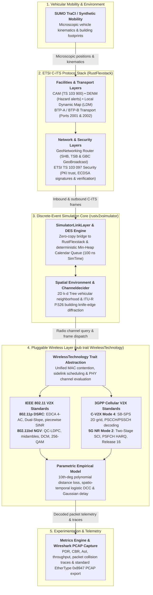

# RustV2XSimulator

<p align="center">
  <strong>High-Performance, Modular Discrete-Event Simulation Framework for Vehicular Communications (V2X) and ETSI C-ITS in Rust</strong>
</p>

---

## Overview

**`rustv2xsimulator`** is a high-performance, modular discrete-event simulation (DES) engine designed for vehicular communications (V2X). Built natively in Rust with deterministic nanosecond-scale scheduling, it bridges microscopic vehicular mobility (via Eclipse SUMO TraCI or synthetic high-density generators) with standard-compliant ETSI C-ITS protocol stacks ([`rustflexstack`](https://flexstack.eu)) and customizable wireless communications.



---

## Key Features

- **Microscopic Deterministic DES**: Min-heap calendar queue operating with strict 100 ns tick resolution (`SimTime`). Deterministic per-receiver PRNG seeds for repeatable academic experiments.
- **Pluggable Multi-Technology Wireless Architecture**: Clean trait-based abstraction (`WirelessTechnology`) supporting standard physical-layer and medium access models:
  - **IEEE 802.11p DSRC**: Dual-slope log-distance path loss, log-normal shadow fading, ITU-R P.526 knife-edge corner diffraction, Rayon-parallel broadcast evaluation, ns-3 v3.42 `InterferenceHelper` piecewise chunked cumulative SINR, 4.0 dB capture effect, and IEEE 802.11p EDCA 4 Access Categories (`AC_VO`, `AC_VI`, `AC_BE`, `AC_BK`).
  - **IEEE 802.11bd Next-Gen V2X**: Mixed-format PPDU (72 µs preamble), L-SIG spoofing for backward compatibility, midamble tracking for Doppler spread at 220 km/h, QC-LDPC forward error correction (+2.5 to 3.0 dB gain), Dual Carrier Modulation (DCM), and MCS 0 to MCS 9 (up to 256-QAM, 40/80 Mbps).
  - **3GPP C-V2X PC5 Sidelink Mode 4**: 10/20 MHz 2D time-frequency grid, Sensing-Based Semi-Persistent Scheduling (SB-SPS), half-duplex exclusion, high-RSRP exclusion, and dual PSCCH/PSSCH decoding.
  - **3GPP 5G NR-V2X Sidelink Mode 2**: Flexible numerologies ($\mu \in \{0, 1, 2\}$, 15/30/60 kHz SCS), Two-Stage SCI (Format 1-A on PSCCH, Format 2-A on PSSCH), Mode 2 autonomous sensing, Release 16 Re-evaluation lookahead ($T_3$), Pre-emption, PSFCH closed-loop HARQ feedback, and 5G NR LDPC/Polar BLER error curves.
  - **Parametric Empirical Model**: Fast 10th-degree polynomial distance loss curve, spatio-temporal logistic congestion tracking, binary building occlusion, and configurable Gaussian delay.
- **Native ETSI C-ITS Protocol Stack**: Full protocol compliance with ETSI EN 302 636-4-1 (GeoNetworking), EN 302 636-5-1 (BTP), TS 103 900 (CAM), and TS 103 097 (Security).
- **Microscopic Mobility**: Bi-directional SUMO TraCI interface and built-in synthetic mobility generators (highways, platoons, urban Manhattan grids).
- **Academic Validation**: Validated against **ns-3 v3.42**, **OMNeT++ Veins 5.2**, **CTTC 5G-LENA**, and the **UWICORE NR-V2X Simulator**, providing rigorous credibility for peer-reviewed academic publications.

---

## Quick Example

Run an automated CAM simulation with 10 vehicles in an urban scenario with IEEE 802.11p DSRC and Decentralized Congestion Control (DCC):

```bash
cargo run --release --example cam_simulation -- \
    --num-vehicles 10 \
    --scenario diagonal \
    --scenario-dir scenarios/diagonal \
    --duration 30.0 \
    --generate-pcap
```

To switch to the fast parametric empirical model:

```bash
cargo run --release --example cam_simulation -- \
    --scenario diagonal \
    --technology parametric \
    --nodes 10 \
    --duration 30.0
```

Inspect the generated packet capture directly in Wireshark:

```bash
wireshark results/cam_example/simulation.pcap
```

---

## Documentation Contents

### Getting Started
- **[Installation](getting_started/installation.md)**: System prerequisites, SUMO setup, and compiling with Cargo.
- **[Quickstart Guide](getting_started/quickstart.md)**: Running your first simulation and inspecting telemetry.
- **[Developer & Integration Guide](getting_started/developer_guide.md)**: Architectural philosophy, downstream repo setup, component overriding, and metrics extraction.

### Architecture & Engine
- **[Core DES Engine](architecture/overview.md)**: In-depth tour of the calendar scheduler and discrete-event lifecycle.
- **[PHY & MAC Architecture](architecture/phy_and_mac_architecture.md)**: Physical-layer channel evaluation, EDCA contention, and frame deciders.
- **[Pluggable Wireless Trait](architecture/trait_abstraction.md)**: How wireless models are decoupled, instantiated, and swapped.
- **[Performance vs OMNeT++](architecture/performance_vs_omnetpp.md)**: Algorithmic optimizations and benchmarks demonstrating 10x–100x speedups.
- **[Mobility & SUMO TraCI](architecture/mobility_engine.md)**: TraCI client, synthetic mobility models, and sub-stepping Krauß collision avoidance.
- **[C-ITS Protocol Stack](architecture/cits_stack.md)**: Integration with RustFlexstack (GeoNetworking, BTP, CAM, DENM, DCC).
- **[Congestion, Collisions & DES](architecture/congestion_collisions_and_des.md)**: Simultaneous transmissions, chunked SINR, and discrete-event timeline mechanics.

### Wireless Technologies
- **[IEEE 802.11p DSRC Model](technologies/dsrc_80211p.md)**: Comprehensive physics, path loss, diffraction, SINR, and EDCA MAC.
- **[IEEE 802.11bd Next-Gen V2X](technologies/wifi80211bd.md)**: Mixed PPDU, midambles, LDPC, DCM, and L-SIG spoofing.
- **[3GPP C-V2X PC5 Mode 4](technologies/cv2x_pc5_mode4.md)**: Sensing-Based Semi-Persistent Scheduling (SB-SPS) and dual BLER.
- **[3GPP 5G NR-V2X Mode 2](technologies/nr_v2x_mode2.md)**: Flexible numerology, Two-Stage SCI, Mode 2 sensing, $T_3$ Re-evaluation, and PSFCH HARQ.
- **[MCS & Bandwidth Analysis](technologies/mcs_analysis.md)**: Modulation, coding rates, symbol timings, and spectral efficiency across all standards.
- **[Parametric Empirical Model](technologies/parametric_legacy.md)**: Polynomial distance loss, logistic congestion, and Gaussian delay.

### Academic Validation & Propagation
- **[Dual-Slope Model & 3GPP TR 38.901 Audit](propagation/dual_slope_model.md)**: Detailed propagation mechanics, breakpoint analysis, and ETSI standards audit.
- **[Veins & Artery Parity & Architecture](validation/veins_artery_parity.md)**: NIST error model, EDCA contention, and OMNeT++ parity.
- **[5G-LENA & UWICORE Parity](validation/5glena_uwicore_nr_v2x_parity.md)**: Mathematical parity and cross-validation for 5G NR-V2X Mode 2.
- **[ns-3 & Veins Validation](validation/ns3_veins_parity.md)**: Verification methodology and benchmark parity.
