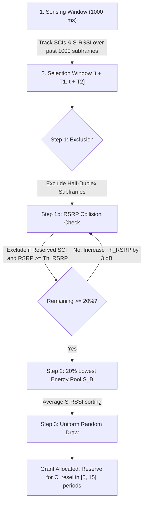

# 3GPP C-V2X PC5 Sidelink Mode 4

## Overview & Standards Provenance

**Cellular Vehicle-to-Everything (C-V2X) PC5 Sidelink Mode 4**, standardized in 3GPP Release 14/15 (*LTE-V2X*), allows direct peer-to-peer vehicular communications in the 5.9 GHz ITS band (**3GPP Band 47**) without requiring cellular tower (eNodeB) coverage or SIM-card subscription.

In contrast to the asynchronous CSMA/CA carrier sense mechanism of IEEE 802.11p, C-V2X Mode 4 organizes communication into a synchronized **2D Time-Frequency Resource Grid** using **Sensing-Based Semi-Persistent Scheduling (SB-SPS)**.

---

## 1. Time-Frequency Sidelink Resource Grid

```
                         C-V2X PC5 MODE 4 RESOURCE GRID
      Frequency (RBs)
        ▲
   50 RB│ Sub-channel 4 [ PSSCH (Data) ] [ PSSCH (Data) ] ...
   40 RB│ Sub-channel 3 [ PSSCH (Data) ] [ PSSCH (Data) ] ...
   30 RB│ Sub-channel 2 [ PSSCH (Data) ] [ PSSCH (Data) ] ...
   20 RB│ Sub-channel 1 [ PSSCH (Data) ] [ PSSCH (Data) ] ...
   10 RB│ Sub-channel 0 [PSCCH (SCI)|TB] [PSCCH (SCI)|TB] ...
        └───────────────────────────────────────────────────► Time (TTI)
                         Subframe t (1ms)  Subframe t+1 (1ms)
```

### 1.1 Channel Bandwidth Options
RustV2XSimulator supports standard 10 MHz and wideband 20 MHz channel configurations:

| Parameter | Standard 10 MHz Channel | Wideband 20 MHz Channel |
|:---|:---:|:---:|
| **Total Resource Blocks (RBs)** | 50 RBs (180 kHz / RB) | 100 RBs |
| **Sub-channel Size** | 10 RBs (1.8 MHz) | 10 RBs (1.8 MHz) |
| **Active Sub-channels per Subframe** | **5 sub-channels** | **10 sub-channels** |
| **Subframe Duration (TTI)** | 1.0 ms | 1.0 ms |
| **Candidate Resources per 100 ms Window** | **500 CSRs** | **1,000 CSRs** |

---

## 2. Physical Channels & Dual Decoding

Sidelink transmissions multiplex two physical channels:

1. **PSCCH (Physical Sidelink Control Channel)**:
   - Occupies 2 Resource Blocks.
   - Carries **Sidelink Control Information (SCI Format 1)**, which announces transmitter priority (PPPP), Resource Reservation Interval ($P_{\text{rsvp}}$), sub-channel index, and MCS.
   - Demodulated using robust QPSK rate 1/2 with an error transition around $\text{SINR} \approx -2.5\,\text{dB}$.
2. **PSSCH (Physical Sidelink Shared Channel)**:
   - Occupies the remaining Resource Blocks in the allocated sub-channel.
   - Carries the actual transport block payload (ETSI CAM, DENM, or custom message).
   - Demodulated using Turbo coding (MCS 0..28, default MCS 7: QPSK 0.58) with an error transition around $\text{SINR} \approx +3.5\,\text{dB}$.

> [!IMPORTANT]
> **Dual Decoding Condition**: In compliance with 3GPP Rel-14, an incoming frame is successfully delivered if and only if **both the PSCCH (SCI) and PSSCH (TB) decode without error**. If the SCI fails, the receiver cannot locate or demodulate the accompanying data block.

---

## 3. Sensing-Based Semi-Persistent Scheduling (SB-SPS)

The core autonomous MAC protocol is defined in **3GPP TS 36.213 Section 14.1.1.6**:



### 3.1 Step 1: Resource Exclusion
When a packet needs scheduling at subframe $t$, all Candidate Single-Subframe Resources (CSRs) within the selection window $[t + T_1, t + T_2]$ (typically $[t + 4\,\text{ms}, t + 100\,\text{ms}]$) are examined (Set $S_A$):

- **Half-Duplex Constraint**: A vehicle cannot receive while transmitting. If the node transmitted during subframe $(x - j \cdot P_{\text{rsvp}})$ in its 1,000 ms sensing history, resource $x$ is excluded.
- **RSRP Thresholding**: If an SCI from another vehicle reserved resource $x$, and its measured Reference Signal Received Power ($\text{PSSCH-RSRP}$) exceeds the threshold $\text{Th}_{\text{RSRP}}$ (default $-110\,\text{dBm}$), the resource is excluded.

### 3.2 Step 2: 20% Condition & Threshold Backoff
If the remaining candidates in $S_A$ are fewer than $20\%$ of the total available resources, the exclusion threshold $\text{Th}_{\text{RSRP}}$ is increased by $+3\,\text{dB}$, and Step 1 is re-evaluated until at least $20\%$ remain.

### 3.3 Step 3: Energy Ranking & Candidate Selection
The remaining candidate resources are sorted by their average past Sidelink Received Signal Strength Indicator (S-RSSI). The lowest $20\%$ energy subset ($S_B$) is formed.

### 3.4 Step 4: Random Draw & Reselection Counter
A single resource is drawn uniformly at random from $S_B$. A **Reselection Counter** ($C_{\text{resel}}$) is drawn:

$$C_{\text{resel}} \sim \mathcal{U}[5, 15]$$

The resource is used periodically every $P_{\text{rsvp}} = 100\,\text{ms}$. With each transmission, $C_{\text{resel}}$ decrements by 1. When it reaches 0:

- With probability $P_{\text{keep}} \in [0.2, 0.8]$ (default 0.4), the vehicle keeps the resource and resets $C_{\text{resel}}$.
- Otherwise, a new resource is reselected.

---

## 4. Interaction with Adaptive ETSI CAM Generation

A frequent question in European C-ITS deployment is: **How does periodic SPS reservation interact with aperiodic, kinematic-driven CAMs (ETSI EN 302 637-2)?**

RustV2XSimulator implements seamless co-existence:

1. **Nominal CAMs (Periodic Driving)**:
   When vehicles cruise at steady speeds, kinematic trigger intervals stabilize around $100\,\text{ms}$ ($10\,\text{Hz}$). The scheduler **reuses the active SPS reservation**, avoiding channel contention and achieving near-zero packet delay.
2. **Kinematic Triggers (Turning / Braking)**:
   When an emergency braking event or sharp curve triggers a CAM earlier than expected ($< 100\,\text{ms}$), the scheduler checks if the upcoming reserved SPS slot falls within the packet latency tolerance ($T_2 \le 100\,\text{ms}$).

   - If the reserved slot is within tolerance, it is utilized.
   - If no grant exists or the deadline would be violated, an immediate **autonomous reselection** is triggered, preventing stale information without creating packet collisions.

---

## 5. Usage in Rust Code

Instantiating and running C-V2X Mode 4 within RustV2XSimulator:

```rust
use rustv2xsimulator::phy::cv2x::config::Cv2xConfig;
use rustv2xsimulator::phy::technology::Cv2xMode4Model;

// Configure standard 10 MHz channel
let mut cv2x_cfg = Cv2xConfig::default();
cv2x_cfg.bandwidth_mhz = 10.0; // 50 RBs, 5 sub-channels
cv2x_cfg.p_rsvp_ms = 100;     // 100 ms SPS reservation interval
cv2x_cfg.tx_power_dbm = 23.0; // 200 mW

let mut model = Cv2xMode4Model::new(cv2x_cfg, 42);
```
