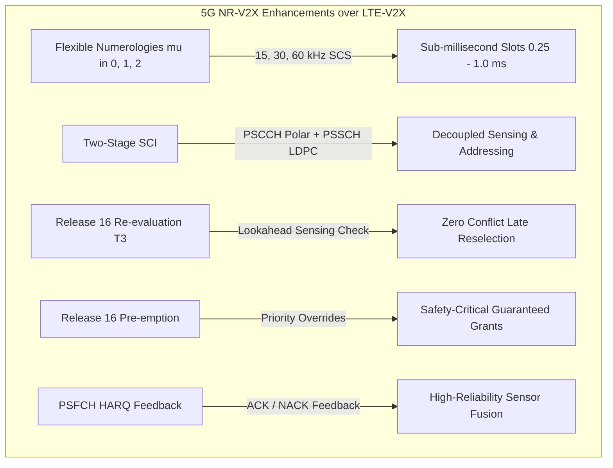
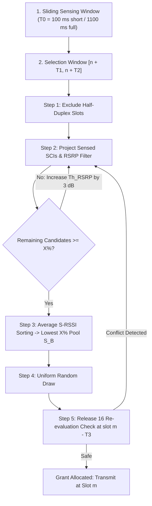

# 3GPP 5G NR-V2X Sidelink Mode 2

## Overview & Standards Provenance

**5G New Radio Vehicle-to-Everything (NR-V2X) Sidelink Mode 2**, standardized in 3GPP Release 16 and Release 17, enables direct peer-to-peer vehicular communication without cellular base station (gNodeB) assistance.

Operating primarily in the 5.9 GHz ITS band (**3GPP Band n47**), NR-V2X enhances sidelink capabilities with flexible numerologies, Two-Stage Sidelink Control Information (2-Stage SCI), autonomous sensing-based resource selection, re-evaluation lookahead, pre-emption, and closed-loop HARQ feedback over the Physical Sidelink Feedback Channel (PSFCH).



---

## 1. Flexible Numerologies & Sidelink Resource Grid

3GPP TS 38.211 Section 4 defines multiple numerologies $\mu$ for sidelink operations:

$$\Delta f = 2^\mu \times 15\,\text{kHz}, \quad T_{slot} = \frac{1.0\,\text{ms}}{2^\mu}$$

| Numerology ($\mu$) | Subcarrier Spacing | Slot Duration | Symbols / Slot | Slots / 1 ms Subframe | Primary Operational Profile |
|:---:|:---:|:---:|:---:|:---:|:---|
| **$\mu = 0$** | $15\,\text{kHz}$ | $1.0\,\text{ms}$ | 14 | 1 | Macro coverage / low-density urban |
| **$\mu = 1$** | $30\,\text{kHz}$ | $0.5\,\text{ms}$ ($500\,\mu\text{s}$) | 14 | 2 | **Standard Default for Band n47 @ 5.9 GHz** |
| **$\mu = 2$** | $60\,\text{kHz}$ | $0.25\,\text{ms}$ ($250\,\mu\text{s}$) | 14 | 4 | High-speed highway & ultra-low latency |

### Sidelink Bandwidth Part (SL-BWP) Partitioning
The channel bandwidth (10, 20, or 40 MHz) is partitioned into subchannels consisting of contiguous Resource Blocks ($S_{sub} \in \{10, 12, 15, 20, 25\}$ RBs):

```
       5G NR-V2X SIDELINK TIME-FREQUENCY RESOURCE GRID (mu = 1, 30 kHz SCS)
    Frequency (RBs)
       ▲
 50 RB │ Subchannel 4 [ PSSCH (Data + SCI-2A) ] ... [ PSFCH (HARQ) ] [ Guard ]
 40 RB │ Subchannel 3 [ PSSCH (Data + SCI-2A) ] ... [ PSFCH (HARQ) ] [ Guard ]
 30 RB │ Subchannel 2 [ PSSCH (Data + SCI-2A) ] ... [ PSFCH (HARQ) ] [ Guard ]
 20 RB │ Subchannel 1 [ PSSCH (Data + SCI-2A) ] ... [ PSFCH (HARQ) ] [ Guard ]
 10 RB │ Subchannel 0 [ PSCCH (SCI-1A) | TB   ] ... [ PSFCH (HARQ) ] [ Guard ]
       └───────────────────────────────────────────────────────────────────────► Time (Slots)
                        Slot n (0.5 ms)                Slot n+1 (0.5 ms)
```

---

## 2. Two-Stage Sidelink Control Information (2-Stage SCI)

Unlike LTE-V2X (which uses a single SCI Format 1), NR-V2X decouples channel sensing from transmission control:

### 2.1 SCI Format 1-A (Stage 1 SCI)
- **Carrier Channel**: Physical Sidelink Control Channel (PSCCH).
- **Modulation & Coding**: QPSK, Polar coded with 24-bit CRC (CRC-24C).
- **Contents**:
  - **Priority**: 3 bits (0 to 7, where 0 is highest priority).
  - **Frequency Resource Assignment (RIV)**: Resource Indication Value.
  - **Time Resource Assignment**: Resource gap to future transmissions.
  - **Resource Reservation Period ($P_{rsvp}$)**: 0 ms (aperiodic) or periodic interval (e.g. 100 ms).
  - **MCS**: 5 bits (0 to 28).
  - **PSFCH Overhead Indicator**: 1 bit indicating whether PSFCH symbols are present.

### 2.2 SCI Format 2-A (Stage 2 SCI)
- **Carrier Channel**: Physical Sidelink Shared Channel (PSSCH).
- **Modulation & Coding**: Polar coded with CRC-24C, multiplexed around DMRS.
- **Contents**:
  - **HARQ Process ID**: 4 bits (0 to 15).
  - **New Data Indicator (NDI)**: 1 bit.
  - **Redundancy Version (RV)**: 2 bits ($0, 2, 3, 1$).
  - **Source Layer-2 ID**: 16 bits.
  - **Destination Layer-2 ID**: 16 bits (or `0xFFFF` for broadcast).
  - **Cast Type**: Broadcast, Groupcast Option 1 (ACK/NACK), Unicast, or Groupcast Option 2 (NACK-only).
  - **HARQ Feedback Enabled Indicator**: 1 bit.

---

## 3. Sensing-Based Mode 2 Autonomous Resource Allocation

Defined in **3GPP TS 38.213 Section 16.6**:



### 3.1 Step 1: Candidate Enumeration & Half-Duplex Exclusion
All Candidate Single-Slot Resources within selection window $[n + T_1, n + T_2]$ are identified. Resources where the UE was transmitting during past sensing cycles are excluded due to half-duplex blindness.

### 3.2 Step 2: Sensed SCI Projection & RSRP Filtering
For each decoded SCI Format 1-A from neighboring UEs:

- If the reservation overlaps candidate $R_{x,y}$ in time and frequency:
  - If measured Reference Signal Received Power ($\text{PSSCH-RSRP}$) exceeds threshold $\text{Th}_{RSRP}$, the candidate is excluded.

### 3.3 Step 3: $X\%$ Condition & Backoff
If the remaining candidates are fewer than $X\%$ of total resources ($X \in \{20\%, 33\%, 50\%\}$):

- Threshold $\text{Th}_{RSRP}$ is increased by $+3\,\text{dB}$ and Step 2 is re-evaluated.

### 3.4 Step 4: S-RSSI Energy Ranking
Remaining candidates are sorted by their average past Sidelink Received Signal Strength Indicator (S-RSSI). The lowest $X\%$ energy subset ($S_B$) is formed.

### 3.5 Step 5: Release 16 Re-evaluation Check ($T_3$)
At slot $m - T_3$ before scheduled transmission:

- The UE evaluates new SCIs received between initial selection and $m - T_3$.
- If another UE claimed the slot with higher priority or earlier timestamp, the UE **drops the grant and reselects**, eliminating packet collisions.

### 3.6 Step 6: Release 16 Pre-emption
Higher-priority safety traffic ($p_1 < p_2$) forcibly claims contested slots, overriding lower-priority reservations during candidate filtering.

---

## 4. Physical Sidelink Feedback Channel (PSFCH) & HARQ

- **PSFCH Periodicity ($N_{PSFCH}$)**: Configurable as 0 (disabled), 1, 2, or 4 slots.
- **Timing Gap**: Designates the first PSFCH slot with offset $K_{PSFCH} \ge 2$ slots after PSSCH.
- **Feedback Modes**:
  - **Unicast**: Positive ACK / Negative NACK.
  - **Groupcast Option 2 (NACK-Only)**: Receiving UEs transmit energy on the shared PSFCH slot only if PSSCH decoding fails.
- **Redundancy Version Progression**: Retransmissions cycle through:

  $$RV \in [0, 2, 3, 1]$$

---

## 5. Physical Layer BLER Error Model (TS 38.214 Table 5.1.3.1-1)

Modulation and Coding Schemes (MCS 0..28) follow standard 3GPP curves calibrated against the UWICORE dataset under TDL-B / TDL-D vehicular fading:

- **PSCCH (Polar code)**: Demodulated with QPSK, error threshold at $\text{SINR} \approx -4.0\,\text{dB}$.
- **PSSCH (NR LDPC)**: Steep logistic waterfall curve:

  $$\text{BLER}(\gamma) = \frac{1}{1 + \exp\left( \frac{\gamma - \gamma_{th}(MCS)}{0.55\,\text{dB}} \right)} \times \text{clamp}\left( \frac{L_{bytes}}{300}, 0.5, 3.0 \right)$$

- **Dual Decoding Rule**: Reception succeeds if and only if **both PSCCH (SCI-1A), PSSCH (SCI-2A), and PSSCH Transport Block decode error-free**.

---

## 6. Rust Configuration Example

```rust
use rustv2xsimulator::phy::nrv2x::{NrV2xConfig, NrV2xMode2Model, NrNumerology};

// 1. Standard 5.9 GHz ITS configuration (30 kHz SCS, 20 MHz bandwidth, 5 subchannels)
let mut cfg = NrV2xConfig::default();
cfg.numerology = NrNumerology::Mu1_30kHz;
cfg.bandwidth_mhz = 20.0;
cfg.subchannel_size_rbs = 10;
cfg.num_subchannels = 5;
cfg.p_rsvp_ms = 100; // 100 ms SPS reservation interval
cfg.pssch_mcs = 10;  // 16-QAM code rate 340/1024
cfg.enable_harq = true;

let mut model = NrV2xMode2Model::new(cfg, 42);
```
