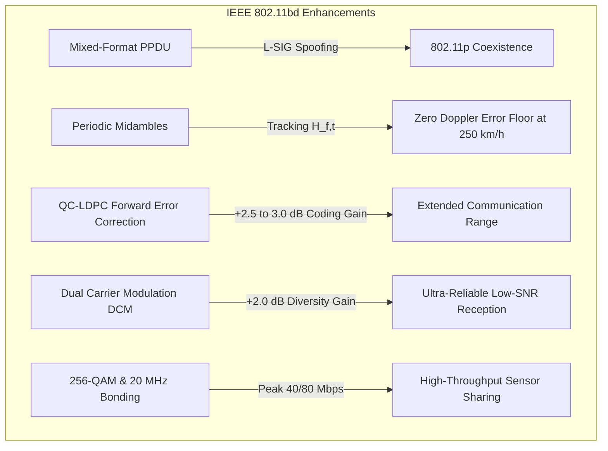

# IEEE 802.11bd Next Generation V2X (NGV)

!!! info "Standardization Status & Standards Reference"
    **Standard**: IEEE Std 802.11bd-2022 (*Amendment 5: Enhancements for Next Generation V2X*), amending IEEE Std 802.11-2020.  
    **Band**: 5.850 – 5.925 GHz Dedicated Short-Range Communications (DSRC) / ITS Band.  
    **Channels**: 10 MHz standard channels (172–184) and optional 20 MHz bonded channels (e.g., 175, 181).  
    **Backward Compatibility**: Full physical coexistence and L-SIG duration protection with legacy IEEE 802.11p.

---

## 1. Overview and Engineering Motivation

IEEE 802.11p (standardized in 2010, incorporated into IEEE 802.11-2012) served as the foundation of vehicular ad-hoc networks (WAVE / ETSI ITS-G5). However, more than a decade of real-world trials revealed three fundamental physical bottlenecks:

1. **High-Speed Doppler Error Floors**: 802.11p channel estimation occurs solely during the preamble ($t=0$). On highways with closing speeds of 200–250 km/h, channel aging causes substantial phase drift across packet symbols, resulting in an inescapable error floor even at high SNR.
2. **Suboptimal Error Correction**: 802.11p relies on convolutional codes (BCC, constraint length $K=7$) decoded by the Viterbi algorithm. Modern Quasi-Cyclic Low-Density Parity-Check (QC-LDPC) codes provide $2.5 - 3.0\text{ dB}$ higher coding gain.
3. **Limited Throughput for Advanced C-ITS**: With a ceiling of 27 Mbps in 10 MHz (64-QAM 3/4), 802.11p cannot accommodate raw sensor sharing, high-density platooning video streams, or collective perception messages (CPM) under high vehicle density.

**IEEE 802.11bd (NGV)** addresses each limitation while preserving sub-millisecond channel access and full backward compatibility with legacy 802.11p stations.



---

## 2. Mixed-Format PPDU and 802.11p Backward Compatibility

IEEE 802.11bd defines a **mixed-format PPDU** ensuring that legacy IEEE 802.11p devices can detect and defer to NGV transmissions without packet corruption.

### 2.1 Preamble Structure

```
+-----------+-----------+---------+---------+-----------+-----------+-----------+----------------------+
|   L-STF   |   L-LTF   |  L-SIG  |  R-SIG  |  NGV-SIG  |  NGV-STF  |  NGV-LTF  | Data + Midambles ... |
|   16 us   |   16 us   |  8 us   |  8 us   |   8 us    |   8 us    |   8 us    |                      |
+-----------+-----------+---------+---------+-----------+-----------+-----------+----------------------+
|<-------- Legacy Preamble (40 us) ------->|<--------- NGV Preamble (32 us) ------->|<---- Payload Data --->|
|<----------------------------- Total Mixed Preamble: 72 us ----------------------->|
```

- **L-STF (Legacy Short Training Field, $16\ \mu\text{s}$)**: Packet detection, coarse frequency offset estimation, automatic gain control (AGC).
- **L-LTF (Legacy Long Training Field, $16\ \mu\text{s}$)**: Fine frequency offset and legacy channel estimation.
- **L-SIG (Legacy Signal Field, $8\ \mu\text{s}$)**: 24 bits transmitted at 3 Mbps (BPSK 1/2). Contains the spoofed `LENGTH` field.
- **R-SIG (Repeated Signal Field, $8\ \mu\text{s}$)**: Exact bit-level duplicate of L-SIG. Provides automatic NGV frame detection and $+3.0\text{ dB}$ repetition combining gain.
- **NGV-SIG (NGV Signal Field, $8\ \mu\text{s}$)**: Signals MCS (0–9), DCM flag, midamble spacing ($N_{\text{mid}}$), and coding parameters.
- **NGV-STF / NGV-LTF ($8\ \mu\text{s}$ each)**: High-resolution AGC realignment and NGV channel estimation.

### 2.2 L-SIG Spoofing Mechanism

To protect the full duration of an 802.11bd transmission from collision by legacy 802.11p stations, the transmitter calculates a fictitious `LENGTH` field in the legacy L-SIG:

$$\text{Duration}_{\text{PPDU}} = T_{\text{preamble}} + (N_{\text{data\_sym}} + N_{\text{mid\_sym}}) \times T_{\text{sym}}$$

$$\text{Spoofed Length (bytes)} = \left\lfloor \frac{\left( \lceil \frac{\text{Duration}_{\text{PPDU}} - 40\ \mu\text{s}}{T_{\text{sym}}} \rceil \times N_{\text{DBPS, legacy}} \right) - 22}{8} \right\rfloor$$

When a legacy 802.11p station decodes L-SIG, it computes the duration and updates its Virtual Carrier Sense / Network Allocation Vector (NAV), freezing channel contention for the exact duration of the 802.11bd transmission.

---

## 3. High-Speed Doppler Mitigation via Periodic Midambles

### 3.1 Mathematical Formulation of Vehicular Doppler Spread

At carrier frequency $f_c = 5.890\text{ GHz}$ ($\lambda = \frac{c}{f_c} \approx 0.05085\text{ m}$), vehicles moving with relative velocity $v_{\text{rel}}$ experience a maximum Doppler frequency shift:

$$f_d = \frac{v_{\text{rel}}}{\lambda} = \frac{v_{\text{rel}} f_c}{c}$$

For highway vehicles approaching each other at $v_{\text{rel}} = 220\text{ km/h} \approx 61.1\text{ m/s}$:

$$f_d = \frac{61.1}{0.05085} \approx 1201.8\text{ Hz}$$

The temporal channel autocorrelation under Clarke / Jakes 2D isotropic scattering follows the zero-order Bessel function of the first kind $J_0$:

$$R_H(\Delta t) = J_0(2\pi f_d \Delta t)$$

The channel estimation error variance $\sigma_e^2(\Delta t)$ after elapsed time $\Delta t$ is:

$$\sigma_e^2(\Delta t) = 2 \left( 1 - J_0(2\pi f_d \Delta t) \right)$$

### 3.2 The 802.11p Doppler Error Floor

In IEEE 802.11p, channel estimation is performed solely at the preamble ($t=0$). Over a typical CAM packet duration ($T_{\text{pkt}} = 500\ \mu\text{s}$), the average channel aging time is $\Delta t = 250\ \mu\text{s}$.

At $f_d = 1200\text{ Hz}$:

$$2\pi f_d \Delta t = 2\pi (1200)(250 \times 10^{-6}) \approx 1.885\text{ rad}$$

$$J_0(1.885) \approx 0.354 \implies \sigma_e^2 \approx 2(1 - 0.354) = 1.292$$

The effective signal-to-interference-plus-noise ratio degrades according to:

$$\text{SINR}_{\text{eff}} = \frac{\text{SINR}}{1 + \text{SINR} \cdot \sigma_e^2}$$

$$\lim_{\text{SINR} \to \infty} \text{SINR}_{\text{eff}} = \frac{1}{\sigma_e^2} = \frac{1}{1.292} \approx 0.774 \approx -1.1\text{ dB}$$

Even with an infinite transmission budget ($\text{SNR} \to \infty$), the effective SINR collapses below $-1\text{ dB}$ due to uncompensated phase rotation across subcarriers, creating an unavoidable physical error floor where all packets fail.

### 3.3 IEEE 802.11bd Midamble Tracking

IEEE 802.11bd inserts periodic NGV-LTF training symbols into the data field every $N_{\text{mid}} \in \{4, 8, 16\}$ OFDM symbols:

| Parameter | $N_{\text{mid}} = 4$ | $N_{\text{mid}} = 8$ | $N_{\text{mid}} = 16$ | None ($N_{\text{mid}}=0$) |
|---|---|---|---|---|
| **Insertion Period** | Every $32\ \mu\text{s}$ | Every $64\ \mu\text{s}$ | Every $128\ \mu\text{s}$ | No midambles |
| **Max Aging $\Delta t$** | $16\ \mu\text{s}$ | $32\ \mu\text{s}$ | $64\ \mu\text{s}$ | $T_{\text{data}} / 2$ ($250\ \mu\text{s}$) |
| **$2\pi f_d \Delta t$ at 220 km/h** | $0.121\text{ rad}$ | $0.242\text{ rad}$ | $0.483\text{ rad}$ | $1.885\text{ rad}$ |
| **$J_0(\text{arg})$** | $0.9963$ | $0.9854$ | $0.9427$ | $0.3542$ |
| **Error Variance $\sigma_e^2$** | **$0.0073$** | **$0.0292$** | **$0.1146$** | **$1.2920$** |
| **Effective SINR ($\text{raw}=25\text{ dB}$)** | **$21.4\text{ dB}$** | **$18.6\text{ dB}$** | **$13.8\text{ dB}$** | **$-1.1\text{ dB}$ (Collapsed)** |

With $N_{\text{mid}} = 4$ or $8$, the channel estimation is continually updated, maintaining correlation $> 98.5\%$ and completely eliminating the high-speed Doppler error floor.

---

## 4. Forward Error Correction: LDPC Codes & Dual Carrier Modulation

### 4.1 Quasi-Cyclic LDPC Coding Gain

IEEE 802.11bd replaces 802.11p convolutional codes with Quasi-Cyclic Low-Density Parity-Check (QC-LDPC) codes ($N \in \{648, 1296, 1944\}$ bits) using iterative belief propagation (BP) decoding.

```
       Packet Error Rate (PER) vs. SINR (300-byte CAM)
  1.0 +-------------------------------------------------------+
      |  IEEE 802.11p BCC (QPSK 1/2)                          |
  0.8 |   \                                                   |
      |    \                                                  |
  0.6 |     \             IEEE 802.11bd LDPC (QPSK 1/2)       |
      |      \                   |                            |
  0.4 |       \                  |  Waterfall Cliff           |
      |        \                 |                            |
  0.2 |         \                |                            |
      |          \               |                            |
  0.0 +-----------\--------------+----------------------------+
      0           4              7                           10
                               SINR (dB)
      |<--- ~2.8 dB Coding Gain --->|
```

- **Coding Gain**: LDPC delivers $2.5\text{ dB}$ to $3.0\text{ dB}$ SNR advantage across all MCS levels at $\text{PER} = 10^{-2}$.
- **Waterfall Characteristic**: The LDPC waterfall transition width ($s \approx 0.45 - 0.65\text{ dB}$) is much steeper than BCC ($s \approx 2.0\text{ dB}$), guaranteeing deterministic reception above the threshold.

### 4.2 Dual Carrier Modulation (DCM)

For safety-critical beacons under harsh multipath fading (e.g., urban intersections or truck-obstructed LOS), IEEE 802.11bd introduces Dual Carrier Modulation (DCM) on MCS 0:

- Each informational bit is modulated onto **two widely separated subcarriers** (separated by half the channel bandwidth, $N_{\text{sub}} / 2$).
- The paired subcarrier uses a $\pi/2$ phase rotation to optimize Euclidean distance.
- **Diversity Gain**: In frequency-selective vehicular fading channels, DCM provides order-2 frequency diversity, yielding an additional **$+2.0\text{ dB}$ gain**, reducing the required SNR for reliable packet delivery from $+1.5\text{ dB}$ down to **$-0.5\text{ dB}$**.

---

## 5. Standard Modulation and Coding Schemes (MCS 0 to MCS 9)

IEEE Std 802.11bd defines 10 standard MCS levels (Table 27-30) supporting up to 256-QAM in both 10 MHz and 20 MHz bandwidths:

| MCS Index | Modulation | Code Rate ($R$) | $N_{\text{DBPS}}$ (10 MHz) | Bitrate (10 MHz) | Bitrate (20 MHz) | 1% PER Threshold | Primary Use Case |
|---|---|---|---|---|---|---|---|
| **MCS 0 (DCM)** | BPSK | 1/2 | 12 | 1.5 Mbps | 3.0 Mbps | **-0.5 dB** | Ultra-reliable emergency beaconing / NLOS |
| **MCS 0** | BPSK | 1/2 | 24 | 3.0 Mbps | 6.0 Mbps | **1.5 dB** | Extended-range warning messages |
| **MCS 1** | QPSK | 1/2 | 48 | 6.0 Mbps | 12.0 Mbps | **4.0 dB** | Standard CAM / DENM broadcast |
| **MCS 2** | QPSK | 3/4 | 72 | 9.0 Mbps | 18.0 Mbps | **6.8 dB** | **Recommended Default** (Balanced throughput/range) |
| **MCS 3** | 16-QAM | 1/2 | 96 | 12.0 Mbps | 24.0 Mbps | **10.2 dB** | Collective Perception Messages (CPM) |
| **MCS 4** | 16-QAM | 3/4 | 144 | 18.0 Mbps | 36.0 Mbps | **13.8 dB** | Maneuver Coordination (MCM) |
| **MCS 5** | 64-QAM | 2/3 | 192 | 24.0 Mbps | 48.0 Mbps | **17.5 dB** | High-density urban sensor sharing |
| **MCS 6** | 64-QAM | 3/4 | 216 | 27.0 Mbps | 54.0 Mbps | **19.2 dB** | High-throughput platoon telemetry |
| **MCS 7** | 64-QAM | 5/6 | 240 | 30.0 Mbps | 60.0 Mbps | **20.8 dB** | Raw camera/radar point cloud stream |
| **MCS 8** | 256-QAM | 3/4 | 288 | 36.0 Mbps | 72.0 Mbps | **24.5 dB** | Ultra-high throughput LOS sensor fusion |
| **MCS 9** | 256-QAM | 5/6 | 320 | **40.0 Mbps** | **80.0 Mbps** | **26.2 dB** | Peak throughput (inter-vehicle file transfer) |

---

## 6. Implementation Architecture in RustV2XSimulator

All 802.11bd functionality is implemented under `src/phy/wifi80211bd/` and integrated with the simulator's pluggable `WirelessTechnology` trait:

```
src/phy/wifi80211bd/
├── mod.rs                  # Module re-exports and public interface
├── consts_80211bd.rs       # PPDU timings, MCS 0..9, midambles, and L-SIG spoofing
├── doppler_model.rs        # Fast Abramowitz-Stegun J0, Doppler spread & midamble tracking
├── ldpc_error_rate.rs      # Analytical LDPC waterfall BLER & DCM diversity models
├── decider_80211bd.rs      # Multi-stage receiver decider (Sensitivity, Preamble, Payload)
├── config.rs               # TOML/Rust configuration struct (10/20 MHz, MCS, Midambles, DCM)
└── model.rs                # Wifi80211bdModel implementing WirelessTechnology trait
```

### 6.1 Configuring 802.11bd in Rust

```rust
use rustv2xsimulator::phy::wifi80211bd::{
    Wifi80211bdConfig, Mcs80211bd, MidamblePeriod, Wifi80211bdModel
};

// 1. Standard balanced highway configuration (10 MHz, 9 Mbps, Midamble Every 8 symbols)
let config = Wifi80211bdConfig {
    bandwidth_mhz: 10.0,
    mcs: Mcs80211bd::Mcs2Qpsk3_4,
    midamble_period: MidamblePeriod::Every8Symbols,
    use_dcm: false,
    tx_power_dbm: 23.0,
    ..Default::default()
};
let model = Wifi80211bdModel::new(config, 42);

// 2. High-speed highway closing (relative speed > 200 km/h: Midamble Every 4 symbols)
let mut high_speed_cfg = Wifi80211bdConfig::default();
high_speed_cfg.midamble_period = MidamblePeriod::Every4Symbols;

// 3. Ultra-reliable emergency configuration (MCS 0 with DCM)
let reliable_cfg = Wifi80211bdConfig::ultra_reliable_dcm();

// 4. High-throughput sensor sharing (20 MHz bonded channel, 36-72 Mbps)
let sensor_sharing_cfg = Wifi80211bdConfig::wideband_20mhz();
```

---

## 7. Comparison Matrix: IEEE 802.11p vs. IEEE 802.11bd

| Dimension | IEEE 802.11p (DSRC) | IEEE 802.11bd (NGV) | Engineering Impact |
|---|---|---|---|
| **Standards Ratification** | IEEE 802.11p-2010 (802.11-2012) | IEEE Std 802.11bd-2022 | Modernized 12-year technology gap |
| **Forward Error Correction** | Convolutional BCC ($K=7$, Viterbi) | Quasi-Cyclic LDPC (BP decoding) | **$+2.5 - 3.0\text{ dB}$ coding gain** |
| **High-Speed Doppler Tracking**| Preamble-only ($t=0$) | Periodic Midambles ($N_{\text{mid}} \in \{4, 8, 16\}$) | **Eliminates error floor at 250 km/h** |
| **Frequency Diversity Mode** | None | Dual Carrier Modulation (DCM) | **$+2.0\text{ dB}$ gain at low SNR (MCS 0)** |
| **Maximum Constellation** | 64-QAM | 256-QAM | High peak spectral efficiency ($8\text{ bits/Hz}$) |
| **Peak Throughput (10 MHz)** | 27.0 Mbps (MCS 7) | 40.0 Mbps (MCS 9) | $+48\%$ higher throughput |
| **Channel Bonding** | 10 MHz fixed | 10 MHz & 20 MHz bonded | Peak throughput doubles to **80.0 Mbps** |
| **Coexistence with 802.11p** | Native | Mixed-format PPDU + L-SIG spoofing | Fully transparent coexistence on shared CCH |

---

## 8. Standards & Academic References

1. **IEEE Std 802.11bd-2022**: *IEEE Standard for Information Technology—Telecommunications and Information Exchange between Systems—Local and Metropolitan Area Networks—Specific Requirements—Part 11: Wireless LAN Medium Access Control (MAC) and Physical Layer (PHY) Specifications—Amendment 5: Enhancements for Next Generation V2X*.
2. **IEEE 802.11-19/0024r0**: *Evaluation Methodology for IEEE 802.11bd*, IEEE 802.11 Next Generation V2X Task Group, 2019.
3. **M. Abramowitz and I. A. Stegun**: *Handbook of Mathematical Functions with Formulas, Graphs, and Mathematical Tables*, National Bureau of Standards, Section 9.4 (Polynomial Approximations for Bessel Functions), 1964.
4. **Q. Gao et al.**: *"IEEE 802.11bd for Next-Generation V2X: Performance, Coexistence, and Verification"*, *IEEE Access*, vol. 9, pp. 119854–119871, 2021.
5. **G. Naik et al.**: *"Next Generation V2X: Evolution of IEEE 802.11p and 3GPP LTE-V2X Towards 5G"*, *IEEE Communications Magazine*, vol. 57, no. 1, pp. 119–125, 2019.
